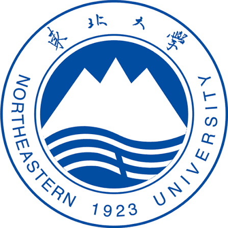

# Hi there, I'm Zhihong Pan (潘志宏) 👋

  
  
  

🌐 **Personal Homepage:** [goodmanpzh.github.io](https://goodmanpzh.github.io) &nbsp;|&nbsp; 📧 **Email:** 2667459138@qq.com

---

## 🎓 About Me

I am currently a second-year Master's student (since Sept. 2024) at the School of Artificial Intelligence and Data Science, **University of Science and Technology of China (USTC)**, advised by A/Res. [Kai Zhang (张凯)](http://home.ustc.edu.cn/~sa517494/). Before that, I received my B.E. degree in Data Science and Big Data Technology from **Northeastern University**.

My current research interests mainly lie in **terminal coding agents**, **agent harness**, **efficient LLM inference**, and **recommender systems / generative recommendation**. 

---

## 🏫 Education

<table>
  <tr>
    <td width="60" align="center"></td>
    <td>
      <strong>University of Science and Technology of China (USTC)</strong> 
      M.S. in Computer Technology, School of Artificial Intelligence and Data Science  
      <em>Sept. 2024 – Present</em>
    </td>
  </tr>
  <tr>
    <td width="60" align="center"></td>
    <td>
      <strong>Northeastern University (NEU)</strong> 
      B.E. in Data Science and Big Data Technology  
      <em>Sept. 2020 – June 2024</em>
    </td>
  </tr>
</table>

---

## 💼 Experience

<table>
  <tr>
    <td width="60" align="center"></td>
    <td>
      <strong>Meituan · LongCat Team</strong> 
      Research Intern (Coding Agent Post-training)  
      <em>Nov. 2025 – Present</em>
    </td>
  </tr>
</table>

---

## publications

- **Meta-Task: Turning Terminal Task Synthesis into a Terminal Task for Scalable Agent Training**  
  **Zhihong Pan**, Jiyuan He, Kai Zhang, Yupeng Han, Ze Liu, Yuze Zhao, Yongcong Ye, Zhaohua Yang  
  *arXiv preprint arXiv:2607.27929, 2026*  
  [🔗 arXiv](https://arxiv.org/abs/2607.27929)

- **Adaptive Model and Strategy Routing for Cost-Efficient LLM Services**  
  **Zhihong Pan**, Kai Zhang, Yuze Zhao, Yupeng Han  
  *ACM Web Conference (WWW), 2026*  
  [📄 PDF](https://doi.org/10.1145/3774904.3792556) | [💻 Code](https://github.com/goodmanpzh/Route-To-Reason)

- **SimCDR: Preserving Intra-Domain Similarities of Users for Cross-Domain Recommendation**  
  Kai Zhang, **Zhihong Pan**, Lei Yu, Qi Liu, Hongke Zhao, Chaochao Chen, Enhong Chen  
  *ACM Transactions on Information Systems (TOIS)*  
  [📄 PDF](https://dl.acm.org/doi/full/10.1145/3774907)

- **Trust, but Verify: Uncertainty-Driven Evidential Multimodal Representation Learning**  
  Yupeng Han, Kai Zhang, Xianquan Wang, **Zhihong Pan**, Ze Liu, Jiyuan He  
  *International Joint Conference on Artificial Intelligence (IJCAI), 2026*  
  [📄 PDF](https://2026.ijcai.org/accepted-papers/)