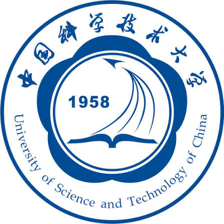

# Hi there, I'm Zhihong Pan (潘志宏) 👋

  
  

🌐 **Personal Homepage:** [goodmanpzh.github.io](https://goodmanpzh.github.io) &nbsp;|&nbsp; 📧 **Email:** 2667459138@qq.com

---

## 👋 About Me

I am a third-year Master's student (since Sept. 2024) at the School of Artificial Intelligence and Data Science,
[University of Science and Technology of China (USTC)](https://www.ustc.edu.cn), advised by A/Res. [Kai Zhang (张凯)](http://home.ustc.edu.cn/~sa517494/).
Before that, I received my B.E. in Data Science and Big Data Technology from [Northeastern University](https://www.neuq.edu.cn/).

🔬 **Research interests**: terminal coding agents · agent harness · efficient LLM inference · recommender systems / generative recommendation

🤝 I'm always open to discussion and collaboration — feel free to reach out via email 😃

---

## 🎓 Education

<table>
  <tr>
    <td width="100" align="center"></td>
    <td>
      <b><a href="https://www.ustc.edu.cn">University of Science and Technology of China (USTC)</a></b> 
      M.S. in Computer Technology, School of Artificial Intelligence and Data Science 
      Sept. 2024 – Present · Advisor: Kai Zhang
    </td>
  </tr>
  <tr>
    <td width="100" align="center"></td>
    <td>
      <b><a href="https://www.neuq.edu.cn/">Northeastern University</a></b> 
      B.E. in Data Science and Big Data Technology 
      Sept. 2020 – June 2024
    </td>
  </tr>
</table>

## 💼 Experience

<table>
  <tr>
    <td width="200" align="center"></td>
    <td>
      <b>Meituan, LongCat Team</b> · Research Intern 
      Coding Agent Post-training 
      Nov. 2025 – Sep. 2026
    </td>
  </tr>
</table>

## 📝 Publications

- **Meta-Task: Turning Terminal Task Synthesis into a Terminal Task for Scalable Agent Training**
  **Zhihong Pan**, Jiyuan He, Kai Zhang, Yupeng Han, Ze Liu, Yuze Zhao, Yongcong Ye, Zhaohua Yang
  *arXiv preprint arXiv:2607.27929, 2026* · [📄 arXiv](https://arxiv.org/abs/2607.27929) · [💻 Code](https://github.com/goodmanpzh/meta-task) · [Ⓜ️ Model](https://huggingface.co/saulpzh/models)

- **Adaptive Model and Strategy Routing for Cost-Efficient LLM Services**
  **Zhihong Pan**, Kai Zhang, Yuze Zhao, Yupeng Han
  *ACM Web Conference (WWW), 2026* · [📄 PDF](https://doi.org/10.1145/3774904.3792556) · [💻 Code](https://github.com/goodmanpzh/Route-To-Reason)

- **SimCDR: Preserving Intra-Domain Similarities of Users for Cross-Domain Recommendation**
  Kai Zhang, **Zhihong Pan**, Lei Yu, Qi Liu, Hongke Zhao, Chaochao Chen, Enhong Chen
  *ACM Transactions on Information Systems (TOIS)* · [📄 PDF](https://dl.acm.org/doi/full/10.1145/3774907)

- **Trust, but Verify: Uncertainty-Driven Evidential Multimodal Representation Learning**
  Yupeng Han, Kai Zhang, Xianquan Wang, **Zhihong Pan**, Ze Liu, Jiyuan He
  *International Joint Conference on Artificial Intelligence (IJCAI), 2026* · [📄 PDF](https://2026.ijcai.org/accepted-papers/)

<!-- ======= 以下是你后续可能要加的模块,按需取消注释 ======= -->

<!--
## 🚀 Projects
- **项目名** — 一句话介绍 · [Code](链接)

## 🏆 Honors & Awards
- 奖学金 / 竞赛名称, 年份

## 🛠 Skills

## 📣 News
- **2026.xx** Paper xxx accepted by xxx
-->
